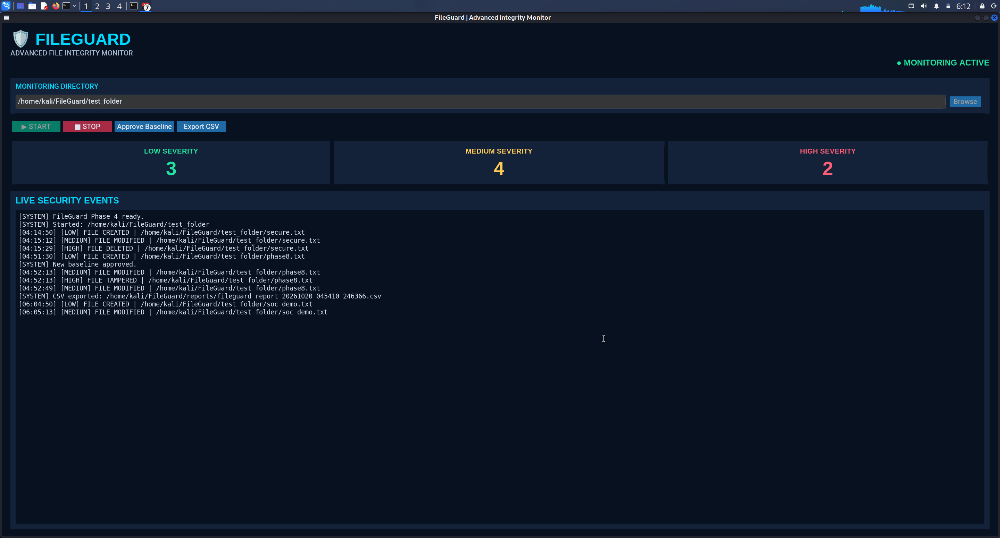

# FileGuard

### Python-Based File Integrity Monitoring & SOC Investigation Tool

FileGuard is a defensive cybersecurity project built with Python
and CustomTkinter for monitoring file integrity and investigating
filesystem changes on Linux.
## FileGuard SOC Dashboard



### Security Monitoring Capabilities

- Real-time filesystem monitoring
- SHA-256 integrity verification
- LOW, MEDIUM and HIGH severity alerts
- File tampering detection
- SOC investigation and event filtering
- Security report generation
### Security Monitoring Capabilities

- Real-time filesystem monitoring
- SHA-256 integrity verification
- LOW, MEDIUM and HIGH severity alerts
- File tampering detection
- SOC investigation and event filtering

- Real-time filesystem monitoring using Watchdog
- SHA-256 file integrity verification
- Persistent file integrity baselines
- File creation, modification and deletion alerts
- Severity-based event classification
- Offline file-change detection
- SOC investigation dashboard
- Event search and filtering
- JSONL audit logging
- CSV and JSON report export
- Single-window security dashboard

## Technology Stack

- Python 3
- CustomTkinter
- Watchdog
- hashlib
- JSON / CSV
- pytest

## Installation

Clone the repository:

```bash
git clone <YOUR_REPOSITORY_URL>
cd FileGuard
```

Create a virtual environment:

```bash
python3 -m venv .venv
source .venv/bin/activate
```

Install dependencies:

```bash
python -m pip install -r requirements.txt
```

## Run FileGuard

```bash
python fileguard.py
```

## Run Automated Tests

```bash
python -m pytest -v
```

## Project Structure

```text
FileGuard/
├── fileguard.py
├── main.py
├── monitor.py
├── investigation.py
├── requirements.txt
├── README.md
├── .gitignore
└── tests/
    └── test_fileguard.py
```

## Security Notes

- Designed for authorized defensive monitoring.
- SHA-256 detects content differences, not attacker identity.
- Severity labels are heuristic classifications.
- Local baseline checksums are not tamper-proof.
- Rapid intermediate changes may be missed.
- Monitoring logs may contain sensitive file paths.
- This project is a prototype, not a production EDR solution.

## Future Improvements

- Protected or signed baseline storage
- Linux audit subsystem integration
- Improved event correlation
- Automated incident reports
- Threat intelligence enrichment

## License

License to be selected before public release.
```

`<YOUR_REPOSITORY_URL>` placeholder-a GitHub repository create pannadhukapram replace pannuvom.

## Step 5 – Dependency cleanup

`pip freeze` development dependencies-um include pannirukkalam. Namma application-ku required packages mattum separate-ah maintain pannuvom.

```bash
python -m pip show customtkinter watchdog
```

Current installed versions check pannittu `requirements.txt`-la minimum required packages write pannuvom:

```bash
printf "customtkinter\nwatchdog\n" > requirements.txt
```

Automated testing-ku:

```bash
printf "pytest\n" > requirements-dev.txt
```

GitHub users application install panna:

```bash
python -m pip install -r requirements.txt
```

Testing panna:

```bash
python -m pip install -r requirements-dev.txt
```

## Step 6 – GitHub safety verification

Ippo `.gitignore` verify pannuvom. GitHub-la logs, reports, backups, virtual environments upload aaga koodadhu.

Terminal-la:

```bash
cat .gitignore
```

Phase 8 Part A-la create pannirundha file-la indha entries irukkanum:

```gitignore
.venv/
venv/
__pycache__/
*.pyc

logs/
reports/
backups/
test_folder/

.env
.env.*
!.env.example

.vscode/
.idea/

*.tmp
*.swp
```

Additional-ah sensitive data or credentials code-la hardcode pannirukkomanu check pannuvom:

```bash
grep -RniE \
'password[[:space:]]*=|api_key[[:space:]]*=|secret[[:space:]]*=' \
--include="*.py" \
--exclude-dir=.venv \
--exclude-dir=backups \
. || true
```

Idhu simple screening mattum. Full secret scanning-ku dedicated tool use pannanum.

## Step 7 – Git initialize pannu

```bash
cd ~/FileGuard

git init
git branch -M main
git add .
git status --short
```

Expected tracked files:

```text
A  .gitignore
A  README.md
A  fileguard.py
A  investigation.py
A  main.py
A  monitor.py
A  requirements.txt
A  requirements-dev.txt
A  tests/test_fileguard.py
```

`logs/`, `backups/`, `reports/`, `test_folder/`, `.venv/` staged files-la irukka koodadhu.

Check:

```bash
git diff --cached --name-only
```

Staged files correct-ah irundha commit pannu:

```bash
git commit -m "Initial FileGuard SOC monitoring release"
```

Git name/email configure pannala-na Git prompt pannum. Appo un GitHub identity configure pannalam.

**Important:** GitHub-ku innum push panna vendam. First tests, staged files, sensitive data checks complete pannuvom.

## Phase 8 Part B – Final Verification

{@body const [checks,setChecks] = DIL.useState([false,false,false,false,false])}
<box border radius="xl" padding={3} gap={3}>
  {#each ["Six automated tests passed","README.md created","requirements.txt and requirements-dev.txt created","Git status contains only safe project files","Initial Git commit successful"] as item,i}
    <checkbox key={i} checked={checks[i]} onChange={v=>setChecks(a=>a.map((x,j)=>i===j?v:x))}>{item}</checkbox>
  {/each}
  <button block disabled={!checks.every(Boolean)} onClick={()=>GenUI.issueNewTurn("FileGuard Phase 8 Part B complete. All six tests passed, Git safety checks completed and commit created. Help me prepare the public GitHub repository and release.")}>Continue to GitHub Release <icon name="arrow-right" inline/></button>
</box>

<box gap={2}>
  **FileGuard development progress**

  <row justify="between" align="center">
    <text color="secondary" size="sm">Completed through Phase 7</text>
    <icon name="check-circle-2" color="success"/>
  </row>
  <row justify="between" align="center">
    <text color="secondary" size="sm">Phase 8 Part A – Monitoring hardening</text>
    <icon name="check-circle-2" color="success"/>
  </row>
  <row justify="between" align="center">
    <text color="secondary" size="sm">Phase 8 Part B – Release preparation</text>
    <badge>Testing</badge>
  </row>
</box>

**Pavi, first `python -m pytest -v` run panni result sollu.** Six tests pass aana next GitHub public release-ku final review pannuvom. 🚀
